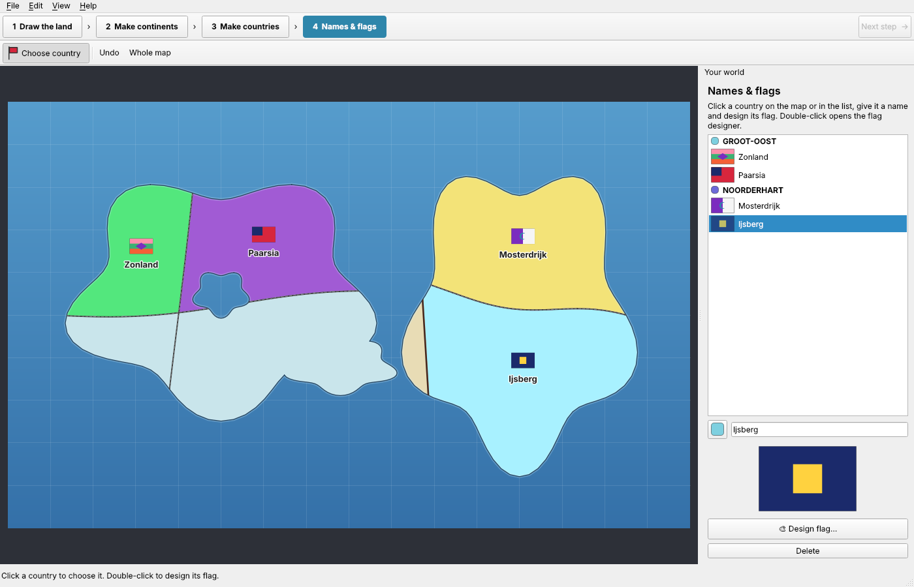

# Vlaggenspel

Draw your own world, split it into continents and countries, then give every
country a name and a flag.



## How to play

1. **Draw the land.** Hold the left mouse button and draw the outline of an
   island or continent. Let go and it fills in. Shapes that touch grow
   together. The right mouse button (or *Make sea*) cuts sea out of the land:
   bays, lakes, straits.
2. **Make continents.** Draw border lines across the land, from sea to sea.
   A line that stops a little short of the coast is stretched to reach it.
   Then click each piece with the **bucket** to make it a continent.
   Shift+click adds another piece (an island, for example) to the selected
   continent.
3. **Make countries.** Same idea, inside the continents. Every new country
   gets its own colour and a surprise flag.
4. **Names & flags.** Click a country, type its name and press
   *Design flag*. In the flag designer you pick a colour and click a stripe
   or shape to paint it, choose lying or standing stripes, and add shapes
   (circle, star, cross, diagonal cross, triangle, diamond, square, moon,
   corner block). Drag a shape to move it. *Surprise me* makes a random flag.

Other controls: scroll to zoom, drag with the middle (or right) mouse button
to move the map, Home shows the whole map, Ctrl+Z / Ctrl+Y undo and redo.
*File → Save* writes a `.vlag` file. *File → Export map as picture* saves a
PNG.

### On a phone or tablet (Android)

- Draw with one finger. Pinch with two fingers to zoom, drag with two fingers
  to move the map.
- *Make sea* replaces the right mouse button, and **➕ Add to chosen** replaces
  Shift+click: switch it on, then tap pieces to add them to the chosen
  continent or country.
- Tap a country to choose it, double-tap to open the flag designer.
- *☰ List* shows or hides the side panel. Held upright, the panel moves under
  the map.
- The ☰ button top-left has New, Open, Save and Export. Your world is also
  saved automatically when you leave the app, and opens again next time.
  Exported pictures go to the app's *Pictures* folder (the path is shown).

## Building

You need **Qt 6** (6.2 or newer) with the *Qt Widgets* module, and CMake.
Nothing else.

### Qt Creator

1. *File → Open File or Project…* and pick `CMakeLists.txt` in this folder.
2. Choose a Qt 6 kit (for example *Desktop Qt 6.x MinGW 64-bit* on Windows)
   and press *Configure Project*.
3. Press the green ▶ Run button (Ctrl+R).

### Android in Qt Creator

1. In the **Qt Maintenance Tool** add *Qt 6.x → Android* (6.8 LTS works well)
   to your Qt installation.
2. In Qt Creator open *Edit → Preferences → Devices → Android* (on macOS
   *Qt Creator → Settings*). Point it at a JDK 17 and press
   *Set Up SDK*; Qt Creator downloads the Android SDK and NDK for you.
3. On your phone switch on *Developer options* and *USB debugging*, and plug it
   in.
4. Open the project, tick the **Android Qt 6.x Clang arm64-v8a** kit, select it
   in the bottom-left kit selector and press ▶ Run. Qt Creator builds the APK,
   installs it on the phone and starts it.

### Ready-made APK from GitHub

Every push is built by GitHub Actions (`.github/workflows/build.yml`). Open
the *Actions* tab, click the latest *Build* run and download
**vlaggenspel-android** at the bottom. Unzip it, copy `vlaggenspel.apk` to the
phone and open it (Android asks you to allow installing apps from that
source). Each build is signed with a new throw-away key, so uninstall the old
version before installing a newer one.

### Command line

```sh
cmake -S . -B build -DCMAKE_BUILD_TYPE=Release
cmake --build build
./build/vlaggenspel        # Windows: build\vlaggenspel.exe
```

On Debian/Ubuntu the packages are `qt6-base-dev`, `cmake` and `g++`.

## Code tour

| File | What it does |
| --- | --- |
| `src/world.*` | The world: land shape, border lines, which pixel belongs to which continent/country, flood fill, saving and loading. |
| `src/mapview.*` | The map widget: drawing, zooming, the bucket, names and flags on the map. |
| `src/flag.*` | A flag (stripes + shapes), how to paint it, random flags. |
| `src/flageditor.*` | The flag designer window. |
| `src/mainwindow.*` | Menus, the four steps, the side panel, undo/redo. |

The map is 1600 × 1000 pixels. The coastline is kept as a vector shape; the
continents and countries are stored per pixel so the bucket fill always
matches what you see.
